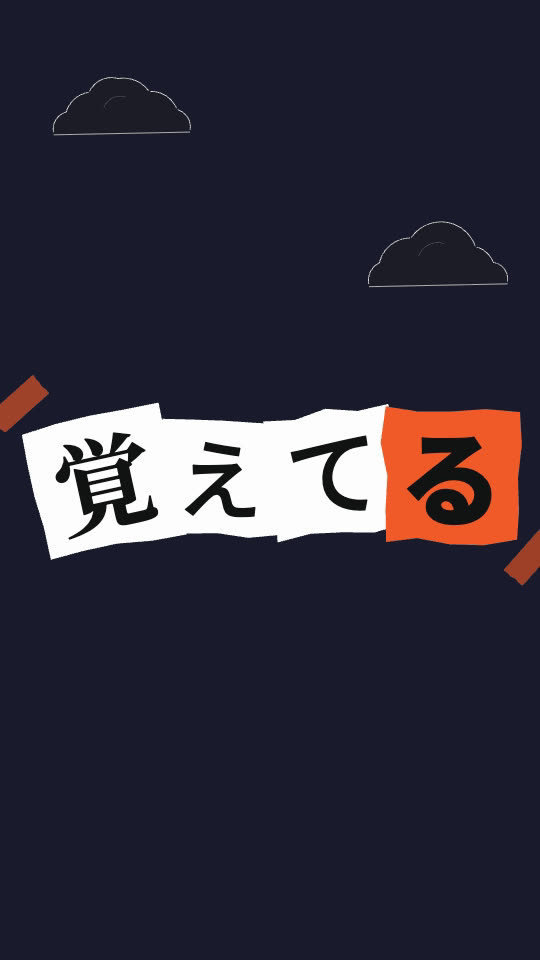

# dsh-jizura

**把日式「文字PV」字幕动画接进 DSH：歌词进，成片出。**

[English](README.en.md) · [上游引擎 JIZURA](https://github.com/852wa/JIZURA)

JIZURA 是一个浏览器里的歌词动画引擎，把 860 个成品部件（版面、入场、待机、退场、装饰、文字处理、背景、镜头、效果、转场）按 seed 确定性地组合成一个个 cut。这个插件把它的引擎原样跑在无头 Chrome 里，包成 DSH 工具，并专门打通了 **HyperFrames 合成**：可以整片出，也可以只出**透明前景/后景层**，交给 HyperFrames 去配音乐、字幕和舞台。


*`jizura_plan` 的产物：每个 cut 一帧。渲全片之前先看这一张。*



*透明分层合成：HyperFrames 的舞台 + `png_back` + `png_front`。*

## 能做什么

| 工具 | 作用 | 要浏览器 |
|---|---|---|
| `jizura_parts` | 查 860 个部件 / 27 个样式包 / 8 种情绪（按组、关键词、部品セット过滤） | 否 |
| `jizura_plan` | 歌词 → cut 计划 + 联络图 + `project.json` | 是 |
| `jizura_render` | 计划 → MP4 / 透明 PNG 序列 + `layers.json` / ProRes 4444 | 是 |
| `jizura_health` | 自检：Chrome、ffmpeg、引擎版本、技能文件 | 否 |

外加技能 **`jizura-hyperframes`**：教 AI 怎么选题材、看联络图、迭代 seed，以及怎么把素材交给 HyperFrames（`skills/jizura-hyperframes/references/handoff.md` 里有 seek-safe 的逐帧 canvas 播放器和三种合成配方）。

## 环境要求

| 需要 | 说明 |
|---|---|
| DSH | 任意近期版本（插件走 `ctx.tools` + `ctx.get('skills')`） |
| Node ≥ 22.4 | 用内置的全局 `WebSocket`，**零 npm 依赖** |
| Chrome / Chromium / Edge | 自动探测；找不到设 `CHROME_PATH` |
| ffmpeg | 需要 `libx264` / `aac` / `prores_ks`；找不到设 `FFMPEG_PATH` |
| 网络 | 渲染时从 Google Fonts 取字体（离线会回退系统字体，`jizura_plan` 会明确报告） |

macOS 一行装 ffmpeg：`brew install ffmpeg`。

## 安装

### 方式 A：从 GitHub（推荐）

```bash
cd ~/.dsh/profiles/desktop
pnpm add github:sunleo994946-source/DSH_JIZURA
```

### 方式 B：本地开发（改完即生效）

```bash
cd ~/.dsh/profiles/desktop
pnpm add dsh-jizura@link:/绝对路径/DSH_JIZURA
```

> `link:` 是指向源码目录的软链，改 `lib/` 里的代码、重启 DSH 就生效，不用重装。

### 然后：把插件加进 profile 的 bundles

编辑 `~/.dsh/profiles/desktop/package.json`，在 `dsh.profile.bundles` 数组里加一项：

```json
{
  "dsh": {
    "profile": {
      "bundles": [
        "@deepseek-ai/dsh-base",
        "@deepseek-ai/dsh-web-app",
        "dsh-drawai",
        "dsh-hyperframes",
        "dsh-jizura"
      ]
    }
  }
}
```

`cordis.patch.yml` 会被 loader 自动应用（和 `dsh-hyperframes` 同一套机制），不用手动改 profile 的 patch 文件。

### 重启 DSH

**插件在启动时加载**，不重启工具和技能不会出现。

### 验证

在会话里让 AI 调用 `jizura_health`，正常会看到：

```
dsh-jizura 自检
  引擎      JIZURA 0.10.1 (fc16bfe)  860 部件 / 27 样式
  Chrome    ✅ /Applications/Google Chrome.app/...
  ffmpeg    ✅ 9.0.2
  技能      ✅ .../skills/jizura-hyperframes/SKILL.md
  浏览器    未启动（首次渲染时启动）
```

### 卸载

```bash
cd ~/.dsh/profiles/desktop
pnpm remove dsh-jizura
# 再从 dsh.profile.bundles 里删掉 "dsh-jizura"，重启 DSH
```

---

## 使用

一次完整的活儿是这样的（AI 会自己按这个顺序走，你只要提供输入）：

```
jizura_parts   看有哪些风格可选
      ↓
jizura_plan    歌词 → 计划 + 联络图   ← 在这里看效果、定稿
      ↓
jizura_render  出 MP4，或出透明层交给 HyperFrames
```

**关键在第 2 步**：`jizura_plan` 会渲一张「每个 cut 一帧」的联络图。先看图、调 seed / 风格，满意了再渲全片——不要跳过这一步直接渲。

### 三种交付形式

| 你要的 | 用哪个 | 说明 |
|---|---|---|
| 独立成片 | `jizura_render mode:"video"` | 一条 H.264 MP4，可混入音轨 |
| 嵌进 HyperFrames（漂浮在舞台上方） | `mode:"video"` + `keyBg:"black"` | 黑底 + CSS `mix-blend-mode: screen`，一个 MP4 搞定，不用逐帧 |
| 嵌进 HyperFrames（前后景夹住人物） | `mode:"layers"` | `png_back/` + `png_front/` + `layers.json`，中间留给你的素材 |

三种拿不准时，`mode:"both"` 全出。

---

## 给 AI 提供什么

这是最影响成败的部分。**只必需要前两项**，其余给得越具体，返工越少。

### 必需

| 项目 | 例子 | 为什么 |
|---|---|---|
| **歌词文本** | 一行一句，贴原文 | 引擎按行切 cut |
| **歌词语言** | `ja` / `zh-Hans` / `zh-Hant` / `ko` / `en` | 决定每个字体角色换成哪种文字的字体。**非日文务必明说**，猜错了整行会混字体 |

### 强烈建议

| 项目 | 例子 |
|---|---|
| **画面比** | `16:9`（B站 / YouTube）、`9:16`（抖音 / Reels）、`1:1`、`4:5`、`21:9` |
| **分辨率 / 帧率** | `1080` / `30`；快歌可用 `60` |
| **交付形式** | 「独立成片」还是「嵌进我现有的 HyperFrames 工程」 |
| **风格方向** | 用描述词就行：「和風、紙感」「赛博、霓虹」「印刷品、黑白」「可爱、糖果色」。AI 会翻译成 `style` / `theme` |
| **禁忌** | 「不要恐怖」「不要竖排」「不要漢字以外的装饰」 |

### 可选，但有会更好

| 项目 | 说明 |
|---|---|
| **音乐文件路径** | `mode:"video"` 时混入音轨。⚠️ 本插件**不做节拍分析**，cut 时长由歌词长度推导；卡拍请在 HyperFrames 侧切 |
| **主题** | `lyricpv` 文字PV / `kinetic` キネティック / `wa` 和風 / `pop` ポップ / `ballad` バラード / `horror` 恐怖（默认不开） |
| **HyperFrames 工程路径** | 要嵌进现成工程就给出目录，AI 才知道素材放哪、帧按什么切 |
| **结构要求** | 「前 4 秒不要歌词，只要背景」「第 2 段留给口播，中间留空」 |
| **可复现要求** | 想以后能重渲同一版，就要 AI 保留 `project.json` 和里面的 `seed` |

### 一段可以直接抄的提示词

```
用 jizura 给这首歌做文字PV。

歌词（日语）：
夜明けの色を/覚えてる
ほどけた声が遠くで鳴った
*透明*なままじゃ終われない!

语言 ja，竖屏 9:16，1080p，30fps。
风格想要和風一点，纸张质感，不要赛博。
先出联络图给我看，我看完再渲。
最后要独立成片的 MP4，音乐用 assets/song.mp3。
保留 project.json，我想以后能重渲。
```

### 你不用做的事

- **不用查部件 key**（`tySquare`、`chochin` 这些）。想指定某种效果就用中文/日文描述，AI 会用 `jizura_parts` 去查。
- **不用指定 seed**。AI 会挑一个并记进 `project.json`。
- **不用手动开浏览器**。第一次渲染时插件自己起无头 Chrome，空闲 5 分钟自动关。

---

## 工具参考

### `jizura_parts`

```
group?:  layout|enter|hold|exit|decor|treat|bg|cam|fx|trans|style|mood
query?:  关键词，匹配 key / 日文名 / 英文名 / 标签
set?:    base|extra|typo|kinetic|horror|wa
limit?:  默认 60，上限 300
```

不开浏览器，秒回。

### `jizura_plan`

```
lyrics*        歌词，一行一句
out?           输出目录，默认 jizura-out/<歌词首句>
aspect?        见上表，默认 16:9
resolution?    720|1080|1440|2160，默认 1080（是画面高度）
fps?           默认 24
seed?          同 seed 同画面；换 seed 是探索变体最便宜的方式
style?         样式 key，例如 noir paper sumi synth80
theme?         lyricpv|kinetic|wa|horror|pop|ballad（会触发 おまかせ 随机化）
lang?          auto|ja|zh-Hant|zh-Hans|ko|en
extra? wa? horror? typo? kinetic?   部品セット开关
unify?         统一感：重复句长得一样
typeset?       文字整列：假名收紧、助词变小
centerFree?    中央留空（给人物 / 口播）
keyBg?         off|green|black（合成用背景）
overrides?     按行号指定：{ "0": { layout, enter, hold, exit, decor, treat, bg, cam, trans, cuts, single } }
```

歌词语法：换行 = 一句，`/` 手动切，`*词*` 强调，`!` 冲击，`[interlude 8]` 8 秒间奏，`[01:23.45]歌词` LRC 时间。

`overrides` 按**行号**（0 起，含间奏行），不是 cut 号——一行可能出多个 cut，它们都吃这一行的设置。

### `jizura_render`

```
projectFile?  jizura_plan 写出的 project.json（推荐，可复现）
project?      或者直接给项目对象
out*          输出目录
mode?         video|layers|both，默认 video
fps? scale?   覆盖帧率 / 分辨率倍数（0.5 = 半尺寸快速预览）
audio?        mode:video 时混入的音轨
crf?          x264 质量，默认 18，越小越好
alphaFormat?  png（默认）| prores
```

`mode:"layers"` 的产出：

```
out/
├── layers.json              清单（宽高、fps、帧数、目录）
├── png_back/f00000.png…     背景图 + 歌词后的装饰
├── png_front/f00000.png…    歌词 + 装饰 + 幽灵 + HUD
└── lyrics_*_prores4444.mov  （alphaFormat:"prores" 时，带 alpha）
```

---

## 它是怎么跑的

不是移植，是**原引擎原样跑在无头 Chrome 里**——JIZURA 的 `12_ui.js` 在没有 `#app` 时自动退出，UI 层和引擎天然分离。

```
lib/index.js      工具定义、串行化、浏览器复用与空闲回收
lib/render.js     工程流：project → plan → 帧 → ffmpeg
lib/cdp.js        零依赖 CDP 客户端 + 浏览器生命周期
engine/engine.js  JIZURA src/*.js 拼接产物（2.2MB，由 tools/bundle-engine.mjs 生成）
engine/driver.js  window.JZ：prepare / frames / cutAt
engine/parts.json 部件目录（日中双语名）
```

两个刻意的选择：

- **编码交给系统 ffmpeg**，不用浏览器 WebCodecs——后者在无头 Chrome 上编码器可用性不稳。
- **纹理也纳入确定性**：引擎的颗粒 / 纸张用 `Math.random`，驱动层在 prepare 时换成按 seed 播种的 PRNG。所以同一份 `project.json` 渲两次逐字节一致。

## 更新引擎

上游 JIZURA 更新后：

```bash
node tools/bundle-engine.mjs --repo /path/to/JIZURA
node test/check.mjs
```

## 自测

```bash
node test/check.mjs    # 静态：包形状、工具 schema、SKILL.md 语法、部件目录（秒级）
node test/smoke.mjs    # 端到端：歌词 → 联络图 → MP4 + 透明层 + ProRes + 可复现性（约 1 分钟）
```

## 故障排查

| 现象 | 原因 / 处理 |
|---|---|
| `jizura_plan` 报「字体缺失 N 个」 | 网络到不了 Google Fonts。这条是硬警告：继续渲会静默回退系统字体，画面和样式包设计不一致 |
| `找不到 Chrome / Chromium` | 装 Chrome，或 `export CHROME_PATH=/path/to/chrome` |
| ffmpeg 相关报错 | `ffmpeg -version` 确认存在；macOS `brew install ffmpeg` |
| 渲染很慢 | 1080p 约实时。长歌先用 `scale:0.5` 预览，定稿再全尺寸 |
| 重启后工具没出现 | 检查 `package.json` 的 `dsh.profile.bundles` 里有没有 `dsh-jizura`，以及 `node_modules/dsh-jizura` 是否存在 |

## 已知限制

- 字体依赖网络；离线渲会漂移（会报告，但不会自动修）。
- **不做音频节拍分析**：cut 时长由歌词长度推导。要卡拍就用 `overrides` 定住每行 cut 数，或在 HyperFrames 侧按拍点切。
- VP9-alpha WebM 故意不提供——ffmpeg 部分构建会静默丢 alpha，出实心底。用 PNG 序列或 ProRes 4444。
- 一次渲染要跑完整片：分多次渲「帧的子集」颗粒会不一致。

## 许可

插件 MIT，见 [LICENSE](LICENSE)。

引擎来自 [852wa/JIZURA](https://github.com/852wa/JIZURA)（MIT），`engine/engine.js` 与 `engine/parts.json` 是其派生产物，版权归原作者——详见 [THIRD_PARTY_NOTICES.md](THIRD_PARTY_NOTICES.md)。
